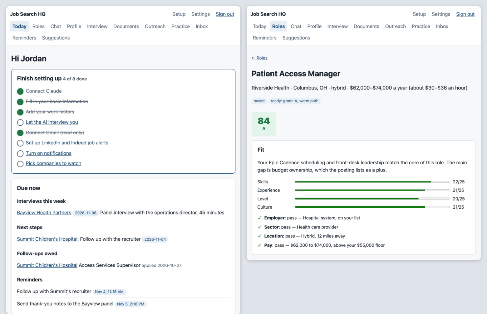

# Job Search HQ

[](https://github.com/grantkovich/job-search-hq/actions/workflows/ci.yml) [](LICENSE)

**Your own private AI job search assistant, for about $20 a month.** Claude reads your job alerts, scores each role against your real experience, interviews you to build your profile, drafts tailored resumes, cover letters and outreach messages, and coaches your interview answers. You approve everything that matters, and it never applies, sends or posts anything for you.



**For any job seeker:** first jobs, hourly and shift work, career changes, returning after a break, mid-career moves and executive roles. The person searching only needs a browser on a phone, Chromebook or computer. The setup is done once, by them or a helper, by pasting one line into Google's browser terminal.

**Start here:** [docs/start-here.md](docs/start-here.md) explains what you need, who does what, and every term, in plain language.

```
git clone https://github.com/grantkovich/job-search-hq.git && cd job-search-hq && bash scripts/install.sh
```
Paste that into [Google Cloud Shell](https://shell.cloud.google.com) from a Windows PC, Mac or Chromebook, and answer its questions. [docs/devices.md](docs/devices.md) shows the keys and windows for each device.

## Highlights

- **Honest drafts:** every resume line must cite a fact from your profile, a check blocks tools you've marked as never used, and a second AI pass compares each claim with its facts. Page count and readability by applicant tracking systems are checked too.
- **Private by design:** your own server, your own Google sign-in, and read-only Gmail. One server hosts a separate copy for each person (you, a family member, a friend), each with its own database, encryption key and network. The AI work is done by Anthropic's Claude, so what each task needs, such as your profile and a posting, is sent to Anthropic.
- **Cheap:** Claude Pro ($20 a month), a Google Cloud free trial, then Google's always-free server, plus about $12 a year for your own web address (or a free sslip.io address to try it, at your own risk). After the trial, small server charges can add up to about $5 a month. [docs/cheap.md](docs/cheap.md) has the details.
- **Works everywhere:** installs like an app on Windows, Mac, Chromebook, iPhone and Android, with push reminders, and it's checked for keyboard and screen-reader use.
- **Built carefully:** a hardened Docker and Caddy stack, AI tools limited to the app's own functions, untrusted text fenced off from the AI, and more than 600 automated tests across unit, browser, real-Claude, Docker and cloud layers.

It runs Claude Code. It isn't made or endorsed by Anthropic, Google or LinkedIn.

## What it does

- **Today:** what's due, interviews this week, follow-ups you owe, roles ready to apply to.
- **Roles:** every job sorted into lanes: ready, your call, needs checking, later, expired. Each has a fit score, pass, fail or unknown checks for employer, sector, location and pay, a timeline, next steps and Undo on every change. Roles a recruiter brings you can be scored without a posting.
- **Profile and AI interview:** your basics, pay in any format or currency (`18/hr`, `60k`, `C$380k`), work history, education, certifications and licenses, projects, facts and skills. The AI interviews you to fill gaps, and nothing is saved until you approve it.
- **Inbox:** reads LinkedIn and Indeed alert emails and employer messages from Gmail. It's read only and never sends, deletes or labels anything. New roles appear, and status updates follow fixed rules with Undo. It can also watch companies' public Greenhouse, Lever and Ashby job boards.
- **Documents:** tailored resume and cover letter PDFs. Every claim cites a fact from your profile, tools you've never used are blocked, and page count and readability by applicant tracking systems are checked before you approve.
- **Practice:** interview questions for each role. Answer by typing or by voice. Audio is deleted after transcription. Answers are scored out of 20, with pace and filler-word counts and the follow-up an interviewer would ask.
- **Chat:** "Acme moved my interview to Thursday at 2." It updates the role, logs the interview, sets a reminder if you ask, and offers Undo. Marking you hired or reopening a closed role stays with you, on the role page.
- **Reminders and notifications:** push notifications to your phone, Chromebook or computer, with Done and Snooze buttons.

## Get started

New to this? Start with **[docs/start-here.md](docs/start-here.md)**. It explains what you need, who does what, and every term, in plain language. You don't need to be technical, and the person searching only ever needs a browser.

1. **The cheap path:** read [docs/cheap.md](docs/cheap.md) for which trials to start and when.
2. **Your device:** [docs/devices.md](docs/devices.md) has the steps for Windows, Mac, Chromebook, iPhone and Android, for both the setup and daily use.
3. **The install:** follow [docs/install.md](docs/install.md). You paste one line into Cloud Shell, Google's terminal in the browser, and it creates the server and walks you through Google sign-in and Claude. Plan on about 90 minutes the first time.
4. **Using it:** [docs/user-guide.md](docs/user-guide.md) walks through each part of the app, with tips for every kind of search, from a first job or hourly work to senior roles.

## How it's built

- **App:** Python (FastAPI, htmx, SQLite). Claude runs through the Claude Agent SDK, using an Anthropic API key or the person's own Claude Pro or Max plan signed in to Claude Code itself.
- **Server:** Docker Compose with Caddy for automatic HTTPS, on a single small VM.
- **Details:** see [docs/design.md](docs/design.md) for the design, [docs/security.md](docs/security.md) for the security model and its limits, and [docs/operations.md](docs/operations.md) for running the server.

## Development

```
uv venv && uv pip install -e ".[dev]" -r requirements.lock
pytest                       # unit and route tests: fake Claude, fake Google, touches nothing real
ruff check src tests && bandit -q -r src -ll && pip-audit -r requirements.lock
```

More test layers, each skipped unless switched on:

| Layer | Run with | What it covers |
|---|---|---|
| Browser | `pip install playwright && playwright install chromium`, then `pytest tests/e2e` | Every flow in Chromium against a live server with the worker running, plus cross-site, framing and stored-script attacks |
| Real Claude | `JOBHQ_LIVE_CLAUDE=login pytest tests/live` (or set `ANTHROPIC_API_KEY`) | Each AI task end to end, tool use, prompt injection, no shell, file or web access, budget cap |
| Voice | `JOBHQ_LIVE_VOICE=clip.m4a pytest tests/live/test_voice.py` | ffmpeg and faster-whisper transcription, with temp audio removed |
| Docker stack | `python scripts/dev/stack_up.py up`, then `JOBHQ_STACK_ROOT=.e2e-root pytest tests/stack/test_docker_stack.py` | Caddy with HTTPS, two copies, container hardening, isolation, PDF, Claude CLI and voice inside the read-only container, restart |
| Cloud | `JOBHQ_CLOUD_VM="name zone project" JOBHQ_CLOUD_HOSTS="a.host b.host" pytest tests/stack/test_cloud.py` | A real install.sh server: trusted certificate, open ports, VM hardening, metadata block, backups |

Run locally without Google by testing through `pytest`. A local run needs a real Google OAuth client with `http://localhost:8000/auth/callback` as a redirect URI and `JOBHQ_BASE_URL=http://localhost:8000`.

## Credits

Built by [Grant Kovich](https://www.linkedin.com/in/grantkovich/), who turned his own Claude Code job-search setup into something anyone can run. It started from Mads Lorentzen's [ai-job-search](https://github.com/ai-job-search-dev/ai-job-search) Claude Code framework (MIT). Released under the MIT License; see [LICENSE](LICENSE).
